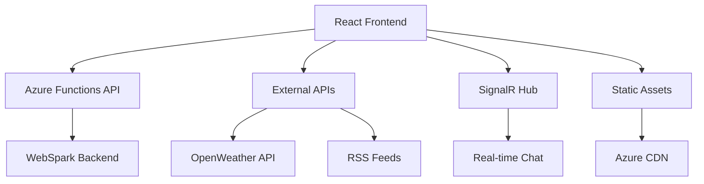

# BootstrapSpark

<div align="center">

**Live Site**: [Bootstrap.makeboldspark.com](https://Bootstrap.makeboldspark.com)

[](https://github.com/MakeBoldSolutions/BootstrapSpark?tab=MIT-1-ov-file)
[](https://github.com/MakeBoldSolutions/BootstrapSpark/stargazers)
[](https://github.com/MakeBoldSolutions/BootstrapSpark/issues)
[](https://github.com/MakeBoldSolutions/BootstrapSpark/actions)
[](https://github.com/MakeBoldSolutions/BootstrapSpark/network)
[](https://github.com/MakeBoldSolutions/BootstrapSpark/commits)

**🚀 A modern, high-performance React portfolio showcasing enterprise-grade web development**

[🌐 Live Demo](https://Bootstrap.makeboldspark.com) • [📖 Documentation](./bold-docs/system/) • [ Report Bug](https://github.com/MakeBoldSolutions/BootstrapSpark/issues)

</div>

---

## About

**BootstrapSpark** demonstrates enterprise-grade React development with React 19, TypeScript, and Vite — live at [Bootstrap.makeboldspark.com](https://Bootstrap.makeboldspark.com).

> Built by [Mark Hazleton](https://markhazleton.com) — Technical Solutions Architect
> Part of the [MakeBoldSpark](https://makeboldspark.com) portfolio of technical demonstrations.

---

## 🎯 Overview

**BootstrapSpark** is a production-ready, enterprise-grade developer portfolio built with React 19, TypeScript, and Vite. It demonstrates modern frontend engineering best practices, serverless architecture, and cloud-native deployment patterns. The project serves as both a personal portfolio and a comprehensive reference implementation for scalable, maintainable web applications.

### ✨ Key Highlights

- 🎨 **Modern UI/UX** - Bootstrap 5 + custom SCSS with dark/light theme switching
- ⚡ **Performance First** - Vite + lazy loading + code splitting for optimal UX
- 🔒 **Type Safety** - Full TypeScript implementation with strict mode
- 🌐 **Multi-Platform** - Dual deployment (Azure Static Web Apps + GitHub Pages)
- 🔄 **Real-time Features** - SignalR chat, live weather, dynamic content
- ♿ **Accessibility** - WCAG compliant with semantic HTML and ARIA
- 📱 **Responsive** - Mobile-first design that works on all devices
- 🚀 **CI/CD Ready** - Automated builds and deployments via GitHub Actions

---

## ⚠️ Important: Content Security Policy (CSP)

**🛑 Before modifying security headers, READ THIS: [Security Guide](bold-docs/system/SECURITY.md)**

This site uses a frontend-only architecture that pulls all content from external sources (markhazleton.com). The CSP configuration is **intentionally permissive** and required for the site to function. Tightening the CSP will break:

- Image loading from markhazleton.com
- Service worker functionality
- Development hot reload
- External API integrations

See the [Security Guide](bold-docs/system/SECURITY.md) for details.

---

## 🏗️ Architecture



---

## 🎭 Features

### 🎨 User Experience

- **🌓 Dark/Light Mode** - Persistent theme switching with smooth transitions
- **📱 Responsive Design** - Mobile-first approach with Bootstrap 5 components
- **⚡ Fast Loading** - Optimized bundle size with lazy-loaded components
- **🔍 SEO Optimized** - Meta tags, Open Graph, JSON-LD structured data
- **♿ Accessible** - WCAG 2.1 AA compliant with keyboard navigation

### 💻 Technical Features

- **🔄 Real-time Chat** - SignalR integration with multiple AI personalities
- **🌤️ Weather Widget** - Live weather data with interactive maps (Leaflet)
- **📰 RSS Integration** - Dynamic blog post feeds with XML parsing
- **🃏 Fun Elements** - Random jokes API integration
- **📊 Project Showcase** - Searchable, sortable portfolio from markhazleton.com
- **🗺️ Interactive Maps** - Location-based weather visualization

### 🛠️ Developer Experience

- **📝 TypeScript** - Strict type safety and IntelliSense support
- **🧪 Modern Tooling** - ESLint, Prettier, SCSS compilation
- **📚 Documentation** - Comprehensive guides in `bold-docs/system/`
- **🔄 Hot Reload** - Instant development feedback with Vite

---

## 🛠️ Technology Stack

<details>
<summary><strong>🎯 Frontend Core</strong></summary>

- **React 19.3** - Latest React with concurrent features
- **TypeScript 6.0** - Type safety and modern JavaScript features
- **Vite 8.3** - Lightning-fast build tool and development server
- **React Router 7.18** - Client-side routing and navigation

</details>

<details>
<summary><strong>🎨 Styling & UI</strong></summary>

- **Bootstrap 5.3.8** - Responsive component framework
- **SCSS/Sass 1.105** - Enhanced CSS with variables and mixins
- **React Bootstrap 2.10** - Bootstrap components for React
- **Bootstrap Icons 1.13** - Comprehensive icon library
- **Bootswatch 5.3** - Bootstrap theme variants

</details>

<details>
<summary><strong>🔧 State & Data</strong></summary>

- **React Context API** - Global state management
- **Native fetch** - HTTP requests with service fallback handling
- **date-fns 4.4** - Modern date utility library
- **DOMParser** - XML parsing for RSS feeds

</details>

<details>
<summary><strong>🌐 APIs & Integration</strong></summary>

- **SignalR 10.0** - Real-time web communication
- **OpenWeather API** - Weather data via WebSpark proxy
- **JokeAPI** - Entertainment content integration
- **Leaflet 1.9** - Interactive maps and geolocation

</details>

<details>
<summary><strong>☁️ Cloud & Deployment</strong></summary>

- **Azure Static Web Apps** - Serverless hosting with CDN
- **Azure Functions** - Serverless API endpoints
- **GitHub Pages** - Alternative static hosting
- **GitHub Actions** - CI/CD automation

</details>

<details>
<summary><strong>🧹 Development Tools</strong></summary>

- **ESLint 10.12** - Code linting and quality
- **TypeScript ESLint** - TypeScript-specific linting
- **Concurrently** - Run multiple npm scripts
- **rimraf** - Cross-platform file removal
- **tsx** - TypeScript execution for scripts

</details>

---

## 📁 Project Structure

```
BootstrapSpark/
├── 📱 src/                          # Source code
│   ├── 🧩 components/               # React components
│   │   ├── About.tsx               # About section with tech stack
│   │   ├── Articles.tsx            # RSS blog integration
│   │   ├── Chat.tsx                # SignalR real-time chat
│   │   ├── Header.tsx              # Navigation with theme toggle
│   │   ├── Hero.tsx                # Landing page hero section
│   │   ├── Projects.tsx            # Portfolio project showcase
│   │   ├── WeatherForecast.tsx     # Weather widget with maps
│   │   └── ...                     # Additional components
│   ├── 🎨 scss/                    # SCSS styling
│   │   ├── components/             # Component-specific styles
│   │   ├── utilities/              # Custom utility classes
│   │   ├── variables/              # SCSS variables and mixins
│   │   └── styles.scss             # Main stylesheet entry
│   ├── 🔧 contexts/                # React context providers
│   ├── 📊 data/                    # Static data files
│   ├── � services/                # API service layers
│   ├── 📝 models/                  # TypeScript interfaces
│   └── ⚙️ utils/                   # Utility functions
├── ☁️ api/                          # Azure Functions
│   └── proxy-rss/                  # RSS proxy function
├── 📖 bold-docs/                   # Project rules, system docs and active work
├── 🏗️ docs/                        # Production build output
├── ⚙️ .github/                     # GitHub workflows and templates
└── 📋 Configuration files          # Various config files
```

---

## 🚀 Quick Start

### 📋 Prerequisites

- **Node.js** >=26.0.0 ([Download](https://nodejs.org/))
- **npm** 12.2.0
- **Git** ([Download](https://git-scm.com/))

### ⚡ Installation

```bash
# Clone the repository
git clone https://github.com/MakeBoldSolutions/BootstrapSpark.git
cd BootstrapSpark

# Install dependencies
npm ci

# Start development server
npm run dev
```

🎉 **That's it!** Open [http://localhost:3000](http://localhost:3000) to see the app.

### 🔧 Available Scripts

| Command                      | Description                                 |
| ---------------------------- | ------------------------------------------- |
| `npm run dev`                | 🚀 Start development server with hot reload |
| `npm run build`              | 📦 Build production bundle                  |
| `npm run preview`            | 👀 Preview production build locally         |
| `npm run lint`               | 🔍 Lint codebase with ESLint                |
| `npm run type-check`         | ✅ Run TypeScript compiler check            |
| `npm test`                   | 🧪 Run unit tests with Vitest               |
| `npm run test:ui`            | 🎨 Run tests with interactive UI            |
| `npm run test:coverage`      | 📊 Run tests with coverage reports          |
| `npm run format`             | ✨ Format code with Prettier                |
| `npm run format:check`       | 🔎 Check code formatting without changes    |
| `npm run clean`              | 🧹 Remove build artifacts and cache         |
| `npm run build-css`          | 🎨 Compile SCSS to CSS                      |
| `npm run watch-css`          | 👁️ Watch and compile SCSS changes           |
| `npm run generate-seo-files` | 📄 Generate sitemap.xml and robots.txt      |

### 📦 Release Flow

Release documentation and GitHub Releases are intentionally connected.

1. Generate release notes and changelog updates for the new version under `bold-docs/system/releases/vX.Y.Z/`.
2. Commit the generated release artifacts.
3. Push the release commit to `main`.
4. Create and push the matching tag, for example `v2.1.0`.

When the tag is pushed, GitHub Actions publishes a GitHub Release whose body comes from `bold-docs/system/releases/vX.Y.Z/release-notes.md` and uploads a packaged build artifact plus checksum.

### 🔒 Code Quality

This project uses automated code quality gates to ensure consistency:

- **Pre-commit Hooks** - Husky runs linting and formatting before commits
- **Prettier** - Automatic code formatting across all file types
- **ESLint** - TypeScript and React best practices enforcement
- **Vitest** - Unit, contract and integration tests; 70% lines/branches and 75% functions
- **TypeScript Strict Mode** - Full type safety across the codebase

**Commit Workflow:**

1. Stage your changes with `git add`
2. Commit triggers automatic formatting and linting on staged files
3. If any issues are found, the commit is blocked until fixed
4. Tests run automatically in CI/CD pipeline

---

## 🌐 Deployment

### 🔵 Azure Static Web Apps (Recommended)

The project is configured for automatic deployment to Azure Static Web Apps:

1. **Automatic CI/CD** - Triggered on push to `main` branch
2. **Serverless API** - Azure Functions for backend services
3. **Global CDN** - Worldwide content delivery
4. **Custom Domains** - SSL certificates included
5. **Preview Deployments** - Automatic PR previews

**Configuration Files:**

- `.github/workflows/azure-static-web-apps-*.yml` - GitHub Actions workflow
- `staticwebapp.config.json` - Azure SWA routing and settings
- `api/` - Azure Functions for serverless backend

### 🟢 GitHub Pages

Alternative deployment to GitHub Pages (requires committing build output):

```bash
# Build for GitHub Pages deployment
npm run build
# Note: docs/ is gitignored. To deploy to GitHub Pages,
# you would need to temporarily unignore or use a CI workflow.
```

**Setup:** Enable GitHub Pages in repository settings, source: `/docs` folder.

---

## 🧪 Testing & Quality

### 🔍 Code Quality

```bash
# Run linting
npm run lint

# Type checking
npx tsc --noEmit

# Check for outdated dependencies
npm outdated
```

### 🛡️ Security

```bash
# Security audit
npm audit

# Fix vulnerabilities
npm audit fix
```

### ♿ Accessibility

- **Semantic HTML** - Proper heading hierarchy and landmarks
- **ARIA Labels** - Screen reader compatibility
- **Color Contrast** - WCAG 2.1 AA compliant
- **Keyboard Navigation** - Full keyboard accessibility

---

## 🤝 Contributing

We welcome contributions! Please see our [Contributing Guide](./bold-docs/system/CONTRIBUTING.md) for details.

### 🔄 Development Process

1. **Fork** the repository
2. **Create** a feature branch (`git checkout -b feature/amazing-feature`)
3. **Commit** your changes (`git commit -m 'Add amazing feature'`)
4. **Push** to the branch (`git push origin feature/amazing-feature`)
5. **Open** a Pull Request

### 📋 Issue Templates

- [� Bug Report](.github/ISSUE_TEMPLATE/bug_report.md)
- [✨ Feature Request](.github/ISSUE_TEMPLATE/feature_request.md)

---

## 📚 Documentation

- 📖 **[Complete Documentation](./bold-docs/system/)** - Comprehensive guides
- ️ **[Architecture Guide](./bold-docs/system/ARCHITECTURE.md)** - System design
- 🚀 **[Deployment Guide](./bold-docs/system/DEPLOYMENT.md)** - Deployment options

---

## 🔗 Related Projects

- **[WebSpark](https://markhazleton.com)** - Backend API ecosystem
- **[PromptSpark](https://promptspark.makeboldspark.com)** - AI prompt engineering

---

## 📈 Performance

- **Lighthouse Score:** 95+ across all metrics
- **Bundle Size:** <500KB gzipped
- **First Contentful Paint:** <1.5s
- **Time to Interactive:** <3s

---

## 🆘 Support

- � **Issues:** [GitHub Issues](https://github.com/MakeBoldSolutions/BootstrapSpark/issues)
- 🐛 **Bug Reports:** Use the bug report template
- ✨ **Feature Requests:** Use the feature request template

---

## 📄 License

This project is licensed under the **MIT License** - see the [LICENSE](LICENSE) file for details.

---

## 🙏 Acknowledgments

- **React Team** - For the amazing framework
- **Microsoft Azure** - For excellent cloud services
- **Bootstrap Team** - For the responsive framework
- **Vite Team** - For the lightning-fast build tool
- **Open Source Community** - For countless contributions

---

<div align="center">

**Built with ❤️ by [Mark Hazleton](https://markhazleton.com)**

[Bootstrap.makeboldspark.com](https://Bootstrap.makeboldspark.com) · Part of the [MakeBoldSpark](https://makeboldspark.com) portfolio

[](https://github.com/markhazleton)
[](https://twitter.com/markhazleton)

[⭐ Star this repo](https://github.com/MakeBoldSolutions/BootstrapSpark) if you find it helpful!

</div>

- **Responsive Design**: Mobile-first, accessible, and optimized for all device sizes (Bootstrap 5.3)
- **Dark/Light Mode**: Theme toggle with persistent context-based state
- **Dynamic Content**: RSS feed integration, real-time weather, jokes, and chat
- **TypeScript**: Strict type safety and modern React patterns
- **SEO Optimized**: Meta tags, Open Graph, and JSON-LD structured data
- **Serverless Backend**: Azure Functions for API/data proxying
- **Dual Deployment**: GitHub Pages & Azure Static Web Apps (with CI/CD)
- **CI/CD**: Automated builds and deployments via GitHub Actions
- **Accessibility**: Semantic HTML, ARIA, and color contrast best practices
- **Performance**: Lazy loading, code splitting, and optimized assets

## 🛠️ Technology Stack

- **Frontend**: React 19.3, TypeScript 6.0, Vite 8.3
- **Styling**: Bootstrap 5.3.8, SCSS/Sass, React Bootstrap, Bootstrap Icons
- **State Management**: React Context API
- **Routing**: React Router v7.5
- **APIs**: Axios, OpenWeather, JokeAPI, SignalR (real-time chat), XML2JS (RSS)
- **Maps**: Leaflet & React Leaflet
- **Markdown**: React Markdown
- **Date Handling**: date-fns
- **Syntax Highlighting**: Prism.js
- **Serverless**: Azure Functions (API)
- **CI/CD**: GitHub Actions
- **Deployment**: Azure Static Web Apps, GitHub Pages

## 📁 Project Structure

```
BootstrapSpark/
├── public/                  # Static assets
├── src/
│   ├── assets/             # Images, SVGs
│   ├── components/         # React components (hooks/, modules/)
│   ├── contexts/           # React context providers
│   ├── css/                # Compiled CSS
│   ├── data/               # Static data (JSON, XML)
│   ├── models/             # TypeScript interfaces/types
│   ├── scss/               # SCSS source files (components/, utilities/, variables/)
│   ├── services/           # API/data services
│   ├── App.tsx             # Main app
│   └── main.tsx            # Entry point
├── api/                    # Azure Functions (serverless API)
├── docs/                   # Production build output
├── .github/                # Workflows, issue/PR templates
├── scripts/                # Utility scripts (SEO, robots.txt, etc.)
├── vite.config.ts          # Vite config
├── tsconfig.json           # TypeScript config
├── staticwebapp.config.json# Azure SWA config
├── swa-cli.config.json     # SWA CLI config
└── package.json            # Dependencies & scripts
```

## 🚀 Getting Started

### Environment & Configuration

- **Node.js**: >=26.0.0
- **npm**: 12.2.0
- **.env files**: Supports environment-specific config via `.env`, `.env.development`, `.env.production`, etc. See `vite.config.ts` for details.
- **Required Variables**: (example)
  - `VITE_BASE_URL` - Base URL for the app
  - `OPENWEATHER_API_KEY` - (if using direct weather API)
  - See `vite.config.ts` and service files for more

### Installation

```pwsh
# Clone the repository
git clone https://github.com/MakeBoldSolutions/BootstrapSpark.git
cd BootstrapSpark

# Install dependencies
npm ci
```

### Scripts

| Script                       | Description                                  |
| ---------------------------- | -------------------------------------------- |
| `npm run dev`                | Start dev server with HMR and SCSS watcher   |
| `npm run build`              | Build production bundle (outputs to `docs/`) |
| `npm run preview`            | Preview local production build               |
| `npm run lint`               | Lint codebase with ESLint                    |
| `npm run clean`              | Remove build artifacts and cache             |
| `npm run build-css`          | Compile SCSS to CSS                          |
| `npm run watch-css`          | Watch and auto-compile SCSS                  |
| `npm run generate-sitemap`   | Generate sitemap.xml                         |
| `npm run generate-robots`    | Generate robots.txt                          |
| `npm run generate-seo-files` | Generate all SEO files                       |

### Development

```pwsh
npm run dev
# Open http://localhost:3000
```

### Linting & Code Quality

- **Lint**: `npm run lint` (uses ESLint, see `eslint.config.js`)
- **Type Checking**: TypeScript strict mode enabled
- **Formatting**: (Recommend using Prettier or VSCode default)

## 📦 Building for Production

```pwsh
npm run build
npm run preview # (optional, to preview build)
```

- Output is in `docs/` (gitignored build artifact — not committed to the repository)
- Azure SWA and CI/CD build from source automatically
- Run `npm run build` before `npm run preview` to generate build output locally

---

## 🔐 Dependency Management & Security

This project uses **Dependabot** for automated dependency updates and security vulnerability detection.

See [NPM dependency usage](bold-docs/system/NPM_DEPENDENCIES.md) for retained packages and compatibility constraints.

### 📚 Dependabot Documentation

When Dependabot PRs appear, use these resources for organized remediation:

- **[scripts/manage-dependabot.ps1](scripts/manage-dependabot.ps1)** - 🤖 PowerShell automation helper

### 🚀 Quick Start for Dependabot PRs

```powershell
# See all open Dependabot PRs organized by priority
.\scripts\manage-dependabot.ps1 -Action list

# Run tests before merging
.\scripts\manage-dependabot.ps1 -Action test-all

# Get guided merge workflow
.\scripts\manage-dependabot.ps1 -Action merge-critical
```

### 🔍 Security Monitoring

```bash
# Check for vulnerabilities
npm audit

# View detailed security report
npm audit --json

# Check GitHub Security tab
# https://github.com/MakeBoldSolutions/BootstrapSpark/security
```

**Note**: All scripts and documentation prioritize security fixes and provide clear guidance for safe dependency updates.

---

## 🧪 Testing

Vitest and React Testing Library cover unit, contract, and integration behavior. Run `npm run test` for watch mode or `npm run test:coverage` for a single coverage run. CI requires 70% lines/branches and 75% functions. Run `npm run build:ci` for lint, type-check, coverage, and production build.

## 🌐 Deployment

Azure Static Web Apps is the primary deployment target. Pull requests run validation; pushes to `main` build and upload the generated `docs/` artifact using Node.js 26 and npm 12.2.0. The Azure action uses `app_location: docs` and `skip_app_build: true`; API source remains in `api/`. Generated artifacts are excluded from source control.

Use `npm run build` and `npm run preview` for local production checks. See the [Deployment Guide](bold-docs/system/DEPLOYMENT.md) and [CI workflow](.github/workflows/azure-static-web-apps-gentle-smoke-063be0b10.yml). GitHub Pages hosting would require a separate artifact workflow and matching Vite base path.

## 🛡️ Maintenance & Updating

- **Dependencies**: Run `npm outdated` and `npm update` regularly
- **Security**: Use `npm audit` and keep dependencies patched
- **Azure Best Practices**: Use managed identity, never hardcode secrets, follow [Azure security guidance](https://learn.microsoft.com/en-us/azure/security/)
- **Accessibility**: Test with screen readers and color contrast tools
- **Performance**: Audit with Lighthouse, optimize images/assets

## ♿ Accessibility, Security & Performance

- **Accessibility**: Semantic HTML, ARIA, alt text, keyboard navigation, color contrast
- **Security**: No secrets in code, uses environment variables, follows Azure best practices
- **Performance**: Lazy loading, code splitting, optimized assets, CDN delivery

## 🤝 Contributing

Contributions are welcome!

- **Issues**: Use [GitHub Issues](https://github.com/MakeBoldSolutions/BootstrapSpark/issues)
- **Pull Requests**: Fork, branch, and submit PRs
- **Code Style**: Follow existing TypeScript/React patterns and lint rules
- **Templates**: See `.github/ISSUE_TEMPLATE/` for bug/feature templates

## ❓ FAQ & Troubleshooting

- **Q: Build fails on Windows?**
  - A: Ensure Node.js >=26.0.0 and npm 12.2.0, use PowerShell, and check for locked files in `node_modules`.
- **Q: Weather/Chat/API not working?**
  - A: Check environment variables and API keys.
- **Q: Styling issues?**
  - A: Run `npm run build-css` and ensure SCSS compiles without errors.
- **Q: How do I update dependencies?**
  - A: `npm update` and review changelogs for breaking changes.

## 🔍 SEO Implementation

- Semantic HTML5, meta tags, Open Graph, JSON-LD, canonical URLs, mobile-friendly, fast loading
- See `index.html` and SEO context for implementation details

## 📝 Blog Posts

- [Building My First React Site Using Vite and GitHub](https://markhazleton.com/articles/building-my-first-react-site-using-vite.html)
- [Adding Weather to My Profile Application](https://markhazleton.com/articles/adding-weather-component-a-typescript-learning-journey.html)
- [Using TypeScript with React: Lessons Learned](https://markhazleton.com/articles/using-typescript-with-react-lessons-learned.html)

## 📄 License

This project is licensed under the MIT License - see the [LICENSE](LICENSE) file for details.

## 📞 Support & Contact

- **Issues**: [GitHub Issues](https://github.com/MakeBoldSolutions/BootstrapSpark/issues)
- **Pull Requests**: Welcome!
- **General Questions**: Please use GitHub Issues for all support and contact

---

Built with ❤️ by the BootstrapSpark community. [Report an issue](https://github.com/MakeBoldSolutions/BootstrapSpark/issues/new)
